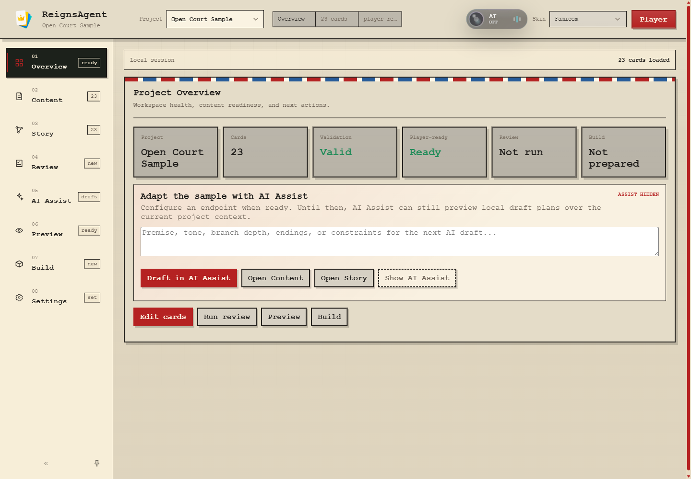
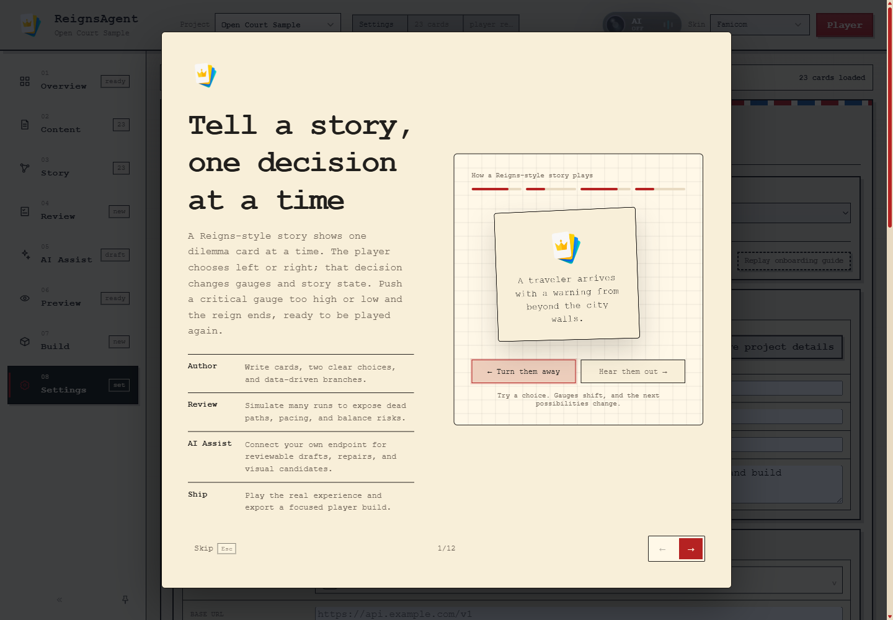
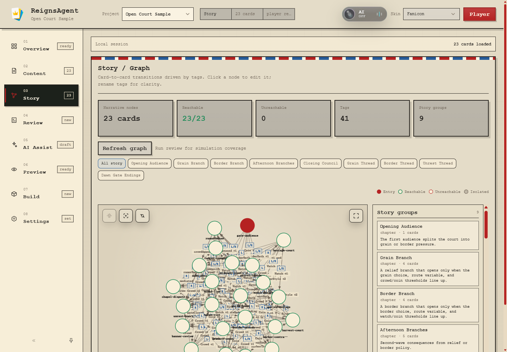
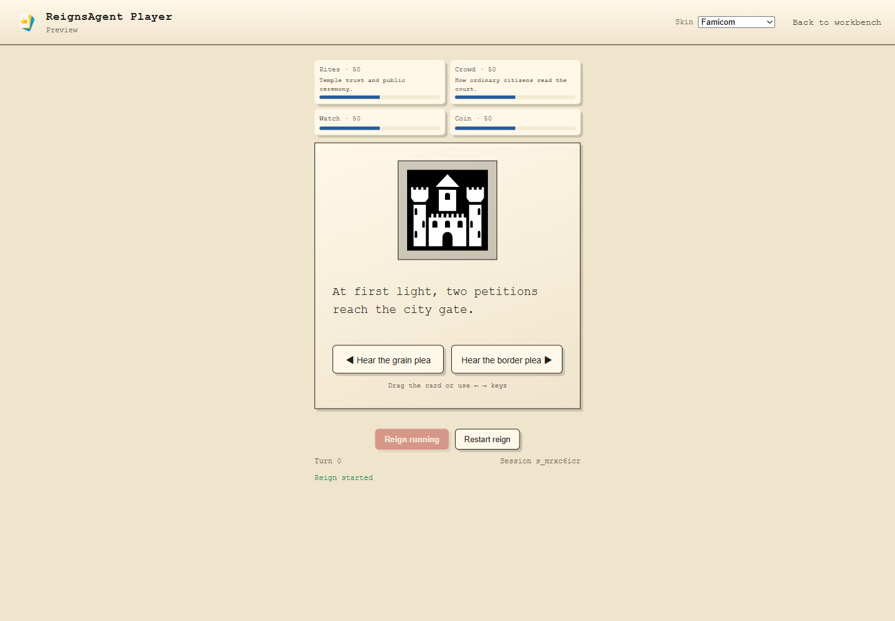
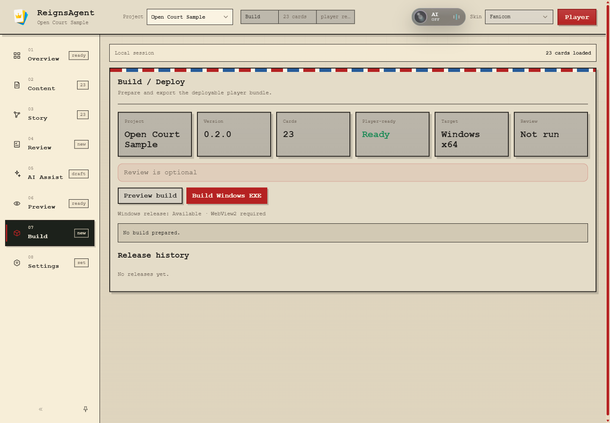
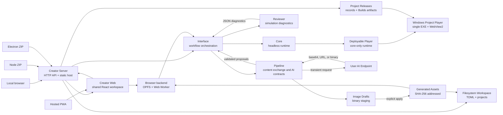
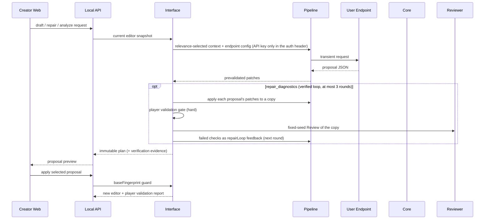

# ReignsAgent

<p align="center">
  
</p>

<p align="center">
  
  
</p>

<p align="center">
  <a href="README.md">English</a> | <a href="README_zh-CN.md">简体中文</a> | Türkçe
</p>

ReignsAgent, [Reigns](https://www.devolverdigital.com/games/reigns) benzeri kart anlatıları için modüler bir yazım, doğrulama ve yayınlama yığınıdır. Bir oluşturucu çalışma tezgahını, deterministik bir başsız (headless) çalışma zamanını, simülasyon tabanlı tanılamayı, içerik içe/dışa aktarma araçlarını ve dağıtılabilir bir oyuncu derleme yolunu bir araya getirir.

Proje iki temel kitle için oluşturulmuştur: anlatı kartı üretimi için pratik bir çalışma alanına ihtiyaç duyan içerik üreticileri ve çalışma zamanı sınırlarını aşmadan içerik taslağı hazırlama, onarma, doğrulama ve yayınlama için net sözleşmelere ihtiyaç duyan yapay zeka destekli iş akışları.

## İçindekiler

- [Buradan Başlayın: Bir İstemci Seçin ve Kullanın](#buradan-başlayın-bir-istemci-seçin-ve-kullanın)
- [İlk Katılım Yoluyla Ürünü Öğrenin](#ilk-katılım-yoluyla-ürünü-öğrenin)
- [Yetenekler](#yetenekler)
- [Tasarım Sınırları](#tasarım-sınırları)
- [Geliştirici Hızlı Başlangıcı](#geliştirici-hızlı-başlangıcı)
- [Oluşturucu İş Akışı](#oluşturucu-iş-akışı)
- [Mimari](#mimari)
- [İçerik Modeli](#içerik-modeli)
- [Yapay Zeka Destekli İş Akışları](#yapay-zeka-destekli-iş-akışları)
- [Derleme Çıktısı](#derleme-çıktısı)
- [Oluşturucu Dağıtımı](#oluşturucu-dağıtımı)
- [Paket Örnekleri](#paket-örnekleri)
- [Depo Düzeni](#depo-düzeni)
- [CI ve Doğrulama](#ci-ve-doğrulama)
- [Teşekkürler](#teşekkürler)
- [Lisans](#lisans)

## Buradan Başlayın: Bir İstemci Seçin ve Kullanın

ReignsAgent iki tür uygulamaya sahiptir. **Creator**, projeleri oluşturmak, incelemek, test etmek ve yayınlamak için kullanılan yazım çalışma alanıdır. **Player**, yalnızca yayınlanmış tek bir projeyi çalıştıran ve sadece sol/sağ oyun deneyimini sunan bilinçli olarak küçültülmüş uygulamadır. Bir Player derlemesi kendi içeriğini düzenleyemez, inceleme (Review) çalıştıramaz veya bir yapay zeka uç noktasına bağlanamaz.

Çoğu sürüm kullanıcısı taşınabilir bir masaüstü Creator ZIP dosyası indirmelidir. Diğer istemciler kurulumsuz tarayıcı kullanımı, sistem-Node iş akışı, geliştirme ve dağıtıma özel ihtiyaçlar için mevcuttur.

| İstemci | En uygun kullanım | Kurulum ve depolama | Önemli ödünleşimler |
| --- | --- | --- | --- |
| **Taşınabilir masaüstü Creator** | Çoğu içerik üreticisi; çevrimdışı yerel çalışma | Platform ZIP dosyasını çıkarın ve `ReignsAgent` uygulamasını çalıştırın. Sistem Node.js veya yükleyici gerekmez. `ReignsAgentData` çıkarılan uygulamanın yanında kalır. | v0.1.0 sürümünde imzasızdır; işletim sistemi uyarı gösterebilir. Taşırken veya yedeklerken uygulamayı ve `ReignsAgentData` dizinini bir arada tutun. |
| **Yerel Node Creator** | Sunucu tarzı yerel kullanım ve halihazırda Node.js'e sahip kullanıcılar | `reigns-agent-<version>.zip` dosyasını çıkarın, Node.js 22+ kurun, ardından `node start.mjs` komutunu çalıştırın. Creator'ı varsayılan tarayıcıda açar ve verileri arşivin yanında saklar. | Creator çalışırken bir terminal süreci açık kalır. |
| **Barındırılan PWA (Hosted PWA)** | Değerlendirme, Chromebook tarzı kullanım veya statik bir dağıtım | Barındırılan URL'yi güncel Chrome veya Edge'de açın. Projeler kaynak kapsamlı (origin-scoped) tarayıcı depolamasında saklanır ve uygulama ilk başarılı yüklemeden sonra çevrimdışı olarak yeniden açılabilir. | Site verilerini temizlemek veya kaynağı (origin) değiştirmek farklı bir çalışma alanı seçer. Düzenli olarak yedek dışa aktarın. Yapay zeka uç noktaları tarayıcı CORS ve HTTPS desteklemelidir. |
| **Kaynak koddan çalıştırma** | Katkıda bulunanlar ve entegratörler | Creator Server'ı ve Vite istemcisini bu depodan çalıştırın. Varsayılan geliştirme çalışma alanı `.reigns-agent-data/` dizinidir. | Node.js 22+, npm bağımlılıkları ve iki geliştirme süreci gerektirir. |
| **Yayınlanmış Player** | Tamamlanmış bir projeyi oynayan kişiler | Yazar tarafından sağlanan dışa aktarılmış Web Player'ı veya projeye özgü Windows EXE'yi açın. | Bilinçli olarak bir Creator istemcisi değildir ve hiçbir zaman Creator, Reviewer, Pipeline, uç nokta ayarları veya kimlik bilgileri içermez. |



_Creator genel görünümü proje kurulumu, kart düzenleme, inceleme, önizleme ve yayınlama arasındaki geçiş noktasıdır. Bu kılavuzdaki ekran görüntüleri paketle birlikte gelen Open Court örneğini ve Famicom temasını kullanır; içerik ve görünüm proje/istemci tercihleridir._

### Bir Sürüm Derlemesi Başlatma

[Releases](https://github.com/Sisyphe42/ReignsAgent/releases) sayfası beş Creator arşivi ve `SHA256SUMS.txt` dosyası içerir:

| İndirme | Hedef | Çıkardıktan sonra başlatma |
| --- | --- | --- |
| `ReignsAgent-win32-x64-<version>.zip` | Windows 10/11 x64 | `ReignsAgent.exe` dosyasını çalıştırın. |
| `ReignsAgent-darwin-arm64-<version>.zip` | Apple Silicon macOS | `ReignsAgent.app` uygulamasını açın. |
| `ReignsAgent-darwin-x64-<version>.zip` | Intel macOS | `ReignsAgent.app` uygulamasını açın. |
| `ReignsAgent-linux-x64-<version>.zip` | Linux x64 | `ReignsAgent` yürütülebilir dosyasını çalıştırın. |
| `reigns-agent-<version>.zip` | Node.js 22+ bulunan herhangi bir platform | `node start.mjs` komutunu çalıştırın; Windows ayrıca `start.cmd`, macOS/Linux ise `start.sh` içerir. |

Uygulamayı ZIP dosyasının içinden çalıştırmayın. Taşınabilir `ReignsAgentData` çalışma alanının yanında oluşturulabilmesi için önce yazılabilir bir dizine çıkarın. Masaüstü arşivleri imzasızdır: Windows SmartScreen, macOS Gatekeeper veya Linux masaüstü politikası ilk başlatmayı onaylamanızı isteyebilir. Mevcut sürümde yükleyici, otomatik güncelleyici, kod imzalama veya noter onayı (notarization) yoktur.

Çıkarmadan önce indirilen arşivi doğrulayın:

```sh
# macOS/Linux, ZIP ve SHA256SUMS.txt dosyalarının bulunduğu dizinden
sha256sum -c SHA256SUMS.txt --ignore-missing
```

```powershell
# Windows PowerShell: sonucu eşleşen SHA256SUMS.txt satırıyla karşılaştırın
Get-FileHash .\ReignsAgent-win32-x64-0.1.0.zip -Algorithm SHA256
```

Masaüstü Creator paylaşılan yerel sunucusunu otomatik olarak başlatır ve uygulama penceresi içinde `/workbench` adresini açar. Node Creator geri döngü (loopback) adresini, normalde `http://127.0.0.1:4321/workbench`, yazdırır ve bu adresi varsayılan tarayıcıda açar. Masaüstü penceresini kapatmak sunucusunu durdurur; Node Creator'ı `Ctrl+C` ile durdurun.

### İlk Katılım Yoluyla Ürünü Öğrenin

İlk katılım (onboarding) kılavuzu, ayrı bir eğitim projesi yerine gerçek Creator'ın 12 adımlı, yerelleştirilmiş bir rehberli turudur. İlk ekranı etkileşimli bir sol/sağ ikilemiyle Reigns tarzı döngüyü açıklar; kalan odak (spotlight) adımları canlı çalışma alanı boyunca ilerler:

| Adımlar | Kılavuzun tanıttıkları |
| --- | --- |
| Giriş | Bir kart, iki karar, dört gösterge (gauge), hikaye durumu değişiklikleri ve bir hükümdarlığı neyin bitirdiği. |
| Project → Content → Story | Boş veya klonlanmış bir örnek projeden başlama, ikili seçimler yazma ve etiket odaklı anlatı yapısını okuma. |
| Review → AI Assist | Yeniden üretilebilir simülasyon tanılaması ve kontrollü, gözden geçirilebilir yapay zeka önerileri. |
| Preview → Build → Player | Üretim kurallarıyla oynama, yayın hazırlığını kontrol etme ve yalnızca oyuncu yüzeyini Creator'dan ayırma. |
| Settings → GitHub → Replay | Çalışma alanı tercihleri ve kalıcılık, proje dokümantasyonu, sürümler, sorun takibi ve turun nereden yeniden başlatılacağı. |



Kılavuz yalnızca geçerli istemci için ilk sıradan `/workbench` ziyaretinde otomatik olarak başlar. `/workbench/content` gibi açık bir derin bağlantı, paylaşılan bağlantıların deterministik kalması için ilk katılıma göre önceliklidir. Tamamlanma durumu korumalı istemci-yerel depolamada saklanır: **Finish**, **Skip** veya `Esc` bir sonraki otomatik başlatmayı engeller; kullanılamayan veya hata fırlatan `localStorage` ise güvenli bir şekilde geri düşer ve Creator başlangıcını engellemez.

Adımlar arasında gezinmek için ekrandaki okları, `Left`/`Right` tuşlarını veya `Space` tuşunu kullanın; `Esc` çıkış yapar. Giriş kartı etkileşimli kalırken, sonraki hedefler düzenleyici, yapay zeka, Review veya Build eylemlerini tetiklemeden vurgulanır. Kılavuz panelleri değiştirdiğinde kapatıldığında turun başladığı paneli geri yükler ve projeleri veya paylaşılan ayarları asla değiştirmez. İstediğiniz zaman hemen yeniden başlatmak için **Settings → Guidance → Replay onboarding guide** yolunu açın.

### İlk Projenizi Oluşturun veya Açın

Şu başlangıç noktalarından birini seçmek için üst çubuktaki **Project** menüsünü kullanın:

1. **New from sample** paketlenmiş bir örneği düzenlenebilir bir projeye klonlar. İki örnek paketlenmiştir: **Open Court** (İngilizce ve Basitleştirilmiş Çince) ve **Fog Harbor** (雾港, yalnızca Basitleştirilmiş Çince, özgün çizimler ve etiket odaklı hikaye zincirleriyle 20 kart). Open Court; dallanma gereksinimlerini, hikaye gruplarını, yerelleştirilmiş içeriği, özel gösterge etiketlerini, görsel bağlamalarını, sonları ve oyuncuya hazır bir desteyi gösterdiği için ilk çalıştırma için önerilir.
2. **New blank project** özgün çalışmalar için boş bir proje oluşturur.
3. **Content** içindeki **Import project** yerel bir dosyadan proje/içerik paketi içe aktarır. Barındırılan PWA ayrıca **Settings → Browser Persistence** altında çalışma alanı ve etkin proje ZIP içe/dışa aktarma seçenekleri sunar.
4. Mevcut bir projeyi seçmek etkin çalışma alanını değiştirir. Silme işlemi proje kapsamındadır ve onay gerektirir.

Paketlenmiş örneğin kendisi değişmezdir; **New from sample** sıradan bir düzenlenebilir kopya oluşturur. Üst çubukta ve sürümlerde gösterilen başlık `content.json.metadata.title` alanından gelirken; yazar, açıklama, bağlantılar, sürüm, yerelleştirme ve gösterge sunumu proje tarafından yazılan meta veriler olarak kalır.

### Tek Bir Oluşturucu İş Akışını Tamamlayın

Numaralandırılmış şerit pratik bir üretim döngüsü olarak sıralanmıştır. Paneller arasında serbestçe gezinebilirsiniz, ancak ilk bir projeyi bu sırayla anlamak en kolaydır.

#### 1. Content İçinde Kart Yazma

Bir paket içe aktarmak, desteyi aramak ve filtrelemek, kart eklemek veya seçmek ve ikilem metnini düzenlemek için **Content** panelini açın. Her oynanabilir kartın tam olarak bir sol seçimi ve bir sağ seçimi vardır. Seçim etkileri dört gösterge yuvasını değiştirebilir ve yazara ait etiketler veya değişkenler ayarlayabilir; gereksinimler bir kartın ne zaman uygun olduğunu belirler. Düşük seviyeli değerleri değiştirmeden önce geçerli kapıyı ve her iki sonucu incelemek için alanların üzerindeki yazar özetini kullanın.

Kaydetme eylemleri, geçerli proje durumu haline gelmeden önce düzenlenmiş şekli doğrular. **player-ready** olarak işaretlenen bir kart Player sözleşmesini karşılar; geçersiz kartlar yazar için görünür kalır ancak bir sürümü engeller. Projeye göre göreceli varlıklar kullanın ve yalnızca dosya adına güvenmek yerine görsel bağlamalarını Preview içinde doğrulayın.

#### 2. Story İçinde Anlatı Yapısını İnceleme

İlk dal var olduktan sonra **Story** panelini açın. Çizge, gereksinimlerden ve etkilerden karttan karta olasılıkları yansıtır; özeti erişilebilir, erişilemez ve yalıtılmış kartları ayırt eder. Hikaye grupları yerleşik oyun sistemleri eklemeden bölümleri, temaları, olay örgülerini veya sonları etiketleyebilir. Kartına dönmek için bir çizge düğümüne tıklayın, bir iş parçacığını yalıtmak için bir hikaye grubuna göre filtreleyin ve etiketleri dikkatlice yeniden adlandırın çünkü bunlar birden fazla kart arasında yazılmış durumu birbirine bağlar.



Çizge erişilebilirliği yapısaldır. Size bir yolun var olup olamayacağını söyler, bir oyuncunun bunu ne sıklıkla göreceğini değil. **Review** simülasyon kanıtı ekler: anlamlı içerik değişikliklerinden sonra çalıştırın, ardından kapsamı, tempoyu, sonları, ölü yolları, gösterge baskısını ve hikaye grubu sağlığını inceleyin. Review bulguları tanılamadır, otomatik düzenlemeler değildir; kasıtlı değişiklikler yapmak ve incelemeyi yeniden çalıştırmak için Content veya Story'ye dönün.

#### 3. İsteğe Bağlı Bir Öneri Katmanı Olarak AI Assist Kullanma

AI Assist, otonom bir yazar veya oyun çalışma zamanının bir parçası değil, isteğe bağlı bir Creator tarafı iş birliği katmanıdır. Yapay zeka denetimini açmak, geçerli Overview, kart, Story seçimi veya Review bulgusu etrafında bağlamsal eylemleri ortaya çıkarır. Bir uç nokta olmadan da yerel bir istek planı oluşturup önizleyebilir; yapılandırılmış bir uç nokta ile bu planı yürütür ve inceleme için öneriler döndürür.

| İş akışı | Girdi ve sonuç |
| --- | --- |
| Proje veya kart taslağı hazırlama | Geçerli proje anlık görüntüsünü bir öncül, ton, dal derinliği, son hedefi, kısıtlamalar, hedef kart ve istenen kart sayısıyla birleştirir. Uç nokta, yeni bir proje yerine açık yama önerileri döndürür. |
| Review onarımı | Tamamlanmış bir Review sonucu gerektirir ve seçilen tanılamayı hedefler. Sınırlı bir doğrula-ve-yeniden-dene döngüsü çalıştırır (en fazla 3 tur): her öneri bir kopyaya uygulanır, oyuncu doğrulamasından geçmelidir, sabit tohumlu bir Review (500 döngü, 40 tur, seed 1) ile puanlanır ve kısayol karşıtı kontrollerden geçmelidir (hedeflenen sorun giderilmiştir, yeni hata yoktur, düzenlemeler ilgili kartlarda kalır (hedefin gereksinim zincirinde eksik olan bir etiket veya değişken için yalnızca bir üretici ekleyen düzenlemeler hariç), yazar kapıları ve seçim etkileri çıkarılmamıştır, hiçbir kart kaldırılmamış veya yeniden adlandırılmamıştır, erişilebilir kartlar ve sağlık puanı düşmemiştir). Başarısız kontroller uç noktaya geri beslenir. Panel tur başına puanları ve her önerinin kontrollerini gösterir; yalnızca geçen öneriler seçili başlar ve siz uygulayana kadar hiçbir şey yazılmaz. |
| Bağlam eylemleri | Talimat açıkça değiştirmediği sürece kimlikleri, etiketleri, değişkenleri ve sol/sağ anlamını koruyarak seçilen kart/çizge bağlamından açıklama, çeviri veya dallanma yapın. |
| Görsel üretim | Yeni görseller oluşturun veya seçilen bağdaştırıcı desteklediğinde referans görseller, düzenleme, iç boyama (inpaint), dış boyama (outpaint), maskeler, en-boy oranları, negatif istemler ve birden çok çıktı adayı kullanın. Sonuçlar uygulanana kadar ikili taslaklar olarak kalır. |

Review onarımı için model, destenin ilgi düzeyine göre seçilmiş bir dilimini görür: önce seçilen ve hedeflenen kartlar, ardından Review sorunları tarafından adlandırılan kartlar, ardından bunların etiketlerini, değişkenlerini veya etkilenen göstergesini paylaşan kartlar (40 kart / 24 KiB ile sınırlandırılmıştır). Taslak kartlar, eski 12 kartlık sınır içinde aynı katmanları kullanır (hedef kart olmadan 12 kart eskisi gibi destenin ilk 12 kartıdır); medya istekleri ilk 12 kartı gönderir. Onarım puanlama ayarları sabittir (500 döngü, 40 tur, seed 1) ve Review paneli ayarlarından bağımsızdır. AI Assist Context sütunu modelin hangi kartları ve neden gördüğünü (target / diagnostic / neighbour / other), kaç tanesinin dışarıda bırakıldığını ve hangi sınırın onları kestiğini (kart sınırı veya bayt bütçesi) gösterir. Bir taslak çalışırken altı ilerleme adımı gerçek arka uç aşamalarını izler (Context, Request, Response veya Local draft, Parse, Validate, Ready); bir onarım döngüsü ayrıca "Round r/3" ve geçerli aşamasını (Request, Trial apply, Scoring, Checks) gösterir ve bir hata gerçekte başarısız olan adımda durur. Review, toplamdan tamamlanan simüle edilmiş döngüleri gösterir ve çalışırken Run review düğmesini devre dışı bırakır. Review ayrıca ölçülen aktarım hızından kalan süreyi tahmin eder ve model çalışırken AI Assist tipik bekleme süresini (bu projenin geçmişindeki son isteklerin medyanı) gösterir. Her onarım döngüsü çalıştırması projede anahtarsız bir kayıt bırakır (`repair-history.json`, en yeni 60 kayıt tutulur, her kayıt en fazla 128 KiB): hedef, tur başına öneri özetleri, puanlar, nedenleriyle birlikte engelleyici kontroller, günlüğe kaydedilmiş model konuşması (sansürlenmiş, her ileti en fazla 16 KiB, uç nokta URL'si veya başlıklar yok), son durum ve yazarın hangi önerileri uyguladığı. AI Assist bu kayıtları listeler, herhangi bir çalıştırmayı tur tur yeniden oynatır ve iki çalıştırmayı yan yana karşılaştırır. Günlüğe kaydedilen her istek gönderilen/alınan belirteçlerini ve baytlarını (uç nokta bir kullanım bildirdiğinde onu, aksi halde "est." olarak işaretlenmiş belirteç başına 4 baytlık bir tahmini) istek başına, tur başına ve çalıştırma başına gösterir ve dışa aktarma bunları içerir. Listenin üzerindeki "Blocking checks" özeti, son 10 onarım döngüsünde hangi kontrolün en çok öneriyi engellediğini sıralar; bir kontrol seçmek listeyi bu çalıştırmalara daraltır. Yazarın Apply sırasında işaretsiz bıraktığı veya uygulayıp sonra geri aldığı öneriler çalıştırmada hatırlanır ve aynı sorun üzerindeki bir sonraki onarım bunlardan en fazla 4 tanesini modele içerik olarak gönderir (Context sütununda "Includes N changes the author declined" olarak, önceki çalıştırmaların engellenen denemelerinden ayrı); kaydı silmek bunları unutur. Döngü içinde model bir sonraki turda en fazla 6 kart daha okumayı isteyebilir (`contextRequests`) veya yazarın karar vermesi gerektiğine hükmettiğinde döngüyü sonlandırabilir (`stop`, `model_stopped` olarak bildirilir); tur sınırı, bütçeler ve her kontrol yine de geçerlidir. Danışma niteliğindeki bir `narrative_quality` kontrolü yer tutucu veya kopyalanmış kart metnini, kullanılamayan seçim etiketlerini ve desteden farklı bir alfabede yazımı işaretler. Barındırılan Creator döngüyü bir Web Worker içinde çalıştırır. Creator Server verdiği her planı imzalar ve sonradan değiştirilen bir planı uygulamayı reddeder (`ai_plan_untrusted`). Yapay zeka katmanındaki seçim eylemleri seçimi yapılandırılmış içerik olarak gönderir (Explain yalnızca yanıtlar; Rewrite/Translate yalnızca seçili kartın metnini ve seçim etiketlerini değiştirebilir), her yapay zeka isteği iptal edilebilir ve projenin yapay zeka etkinlik günlüğüne kaydedilir (dışa aktarılabilir), tüm uç nokta çağrıları için oturum başına istek sınırı uygulanır ve isteğe bağlı bir yazar özeti her istekle birlikte içerik olarak gönderilir ve oyuncu derlemelerinden çıkarılır. Mimari için [docs/architecture/ai-assist.md](docs/architecture/ai-assist.md) dosyasına bakın. `node scripts/repair-eval/live-capture.mjs` anahtarsız bir geri döngü uç noktasına karşı sınırlı bir canlı döngü kaydeder (istek sınırı bir vekil tarafından uygulanır). `npm run eval:repair` onarım döngüsünü betikli bir sahte uç noktaya karşı çevrimdışı çalıştırır (modeli değil, test donanımını ölçer); `npm run eval:repair -- --real --endpoint <loopback URL> --model <id>` gerçek özellikli vakaları anahtarsız bir geri döngü uç noktasına karşı çalıştırır ve kaydedilen sonuçlar `scripts/repair-eval/results/` içinde yer alır.

Metin uç noktası yapılandırması **Settings → AI Endpoint** altındadır. Bir kanal ön ayarı veya özel uç nokta seçin, temel URL'yi ve model kimliğini sağlayın, yapılandırılmış JSON veya görsel algılama (vision) gibi yetenekleri bildirin, ardından gelişmiş denetimleri yalnızca protokol, rota, uyumluluk veya JSON modu geçersiz kılmaları gerektiğinde kullanın. **Fetch `/models`** uyumlu model keşif rotalarını sorgular. **Validate endpoint** bir uyumluluk isteği gönderir ve projeyi düzenlemez.

Görsel yapılandırması **Settings → Image Endpoint** altında bağımsızdır, ancak metin kimlik bilgisini devralabilir. Birinci taraf bağdaştırıcılar OpenAI Images uyumlu rotaları, Gemini Interactions, Stability Stable Image ve Midjourney Proxy/NewAPI'yi kapsar. Creator yalnızca seçilen bağdaştırıcı tarafından duyurulan işlemleri ve parametreleri gösterir; görsel yapılandırmasını doğrulamak ücretli bir üretim başlatmaz.

Bir metin planı oluşturmak geçerli içeriğin parmak izini yakalar. Her öneri özetini ve JSON yamasını inceleyin, yalnızca istediğiniz önerileri seçin ve **Apply selected** seçeneğini belirleyin. Plan oluşturulduktan sonra proje değiştiyse, bayat plan koruması bunu reddeder ve yeni bir plan gerektirir. Yama ön doğrulaması ve Player doğrulaması yine de uygulanır. Görseller için oluşturulmuş bir sonuç seçin ve içerik adresli yerel bir varlığı kaydetmek ve isteğe bağlı olarak bir karta bağlamak için **Apply selected image** seçeneğini kullanın; **Discard draft** hazırlanan adayı kaldırır. Ne metin ne de görsel çıktısı sessizce yazılmış veya yayınlanmış içerik haline gelmez.

Yerel ve masaüstü istemcileri uç noktaları Creator Server aracılığıyla çağırır. Barındırılan sürüm bunları doğrudan tarayıcıdan çağırır, bu nedenle uç noktanın CORS aracılığıyla Creator kaynağına, `Authorization` ve `Content-Type` başlıklarına izin vermesi gerekir; HTTPS bir Creator, localhost dışında bir HTTPS uç noktası da gerektirir. ReignsAgent bir yapay zeka aktarma sunucusu (relay) işletmez.

Kaydedilen yerel uç nokta anahtarları ürün tercihi gereği düz metin yerel yapılandırmadır, arayüzde maskelenir ve Player derlemelerinden, günlüklerden ve sıradan proje dışa aktarımlarından hariç tutulur. Barındırılan yedek dışa aktarımı varsayılan olarak düz metin anahtarını hariç tutar ve dahil etmek için açık bir onay gerektirir. Asla bir `VITE_*` derleme değişkenine özel anahtar koymayın.

#### 4. Gerçek Seçim Döngüsünü Önizleme

Gömülü bir oturum için **Preview** veya özel Player sayfası için sağ üstteki **Player** düğmesini kullanın. Bir hükümdarlık başlatın, ardından sol/sağ kararına tıklayarak, ok tuşlarına basarak, bir işaretçiyle sürükleyerek veya dokunmatik ekranda kaydırarak seçim yapın. Gösterge tepkisini ve sonraki kart seçimini izleyin. Kritik bir göstergeye ulaşmak geçerli hükümdarlığı sonlandırır ve anında yeniden başlatma sunar.



Player bağlantısı geçerli temayı, arayüz yerel ayarını, masaüstü işaretçisini ve dönüş bağlamını taşır. Yayınlanmış bir Player'ın kendi görünüm, dil, oyun kaydı ve hakkında denetimleri vardır, ancak yazım yüzeyi yoktur. Yayınlamadan önce her zaman özel Player'ı test edin çünkü bu, kart JSON'unu okumaktan veya yalnızca gömülü önizlemeyi kullanmaktan daha yakın bir deneyim sunar.

#### 5. Hazırlama ve Yayınlama

Her kart oyuncuya hazır olduğunda **Build** panelini açın. **Preview build** dağıtılabilir içerik/çalışma zamanı sınırını doğrular ve birleştirir. Önce Review çalıştırılması önerilir, ancak yayın engelleyicisi Player doğrulamasıdır.



Çıktı istemciye bağlıdır:

| Creator barındırıcısı | Yayınlama yolu |
| --- | --- |
| Windows x64 üzerinde yerel Node veya masaüstü Creator | **Build Windows EXE** deterministik bir proje sürümü oluşturur veya yeniden kullanır ve bunu sürüm geçmişine kaydeder. Hedef makinenin Windows 10/11 x64 ve Microsoft Edge WebView2 Evergreen Runtime'a ihtiyacı vardır. |
| Barındırılan PWA | Tarayıcıda birleştirilen bir Web Player ZIP dosyası dışa aktarın. |
| Desteklenen herhangi bir platformda kaynak veya çıkarılmış Node dağıtımı | Statik bir Player sitesi oluşturmak için depoda `npm run build:game -- <content.json> <output-dir>` veya Node dağıtımında `node scripts/build-game.mjs <content.json> <output-dir>` komutunu çalıştırın. |

Windows proje EXE'leri v0.1.0 sürümünde imzasızdır ve yalnızca proje paketini, Player varlıklarını, birleştirilmiş Core çalışma zamanını ve kısıtlı yerel barındırıcıyı içerir. Creator Web, Creator Server, Pipeline, Reviewer, yapay zeka bağlayıcıları, uç nokta ayarları veya kimlik bilgileri içermezler.

### Çalışmanızın Nerede Yaşadığını Bilin

| İstemci | Kalıcı çalışma alanı | Yedekleme ve taşınabilirlik |
| --- | --- | --- |
| Taşınabilir masaüstü Creator | Çıkarılan uygulamanın yanında `ReignsAgentData/`. | Uygulamayı ve veri dizinini birlikte taşıyın veya kopyalayın. Proje sürümleri `ReignsAgentData/Builds/<project-id>/` altındadır. |
| Yerel Node Creator | `REIGNS_AGENT_DATA_ROOT` ayarlanmadıkça çıkarılan Node dağıtımının yanında `ReignsAgentData/`. | Dizini kopyalamadan önce sunucuyu durdurun. Çalışma alanı ve proje verileri masaüstüyle aynı düzeni kullanır. |
| Kaynak koddan çalıştırma | `REIGNS_AGENT_DATA_ROOT` ayarlanmadıkça varsayılan olarak depo kökünde `.reigns-agent-data/`. | Bunu işlenecek kaynak kod değil, yerel çalışma zamanı verisi olarak görün. |
| Barındırılan PWA | Tarayıcı profilinde kaynak kapsamlı OPFS. | Bir çalışma alanı yedeği veya etkin proje ZIP'i dışa aktarmak için **Settings → Browser Persistence** yolunu kullanın. Site verilerini temizlemek yerel çalışma alanını yok eder; farklı bir şema, ana bilgisayar veya bağlantı noktası farklı bir çalışma alanıdır. |
| Yayınlanmış Player | Yalnızca tarayıcı/yerel tercihler ve sınırlı oyun kayıtları. | Oluşturulduğu Creator projesine sahip değildir veya onu değiştirmez. |

Depoya katkıda bulunanlar için bu README ürün kullanımını, sürüm davranışını, mimariyi ve doğrulama giriş noktalarını kapsar. Kalıcı uygulama sınırları, ajan davranışı, Git politikası ve değişikliğe özel test gereksinimleri [AGENTS.md](AGENTS.md) içinde yer alır; sistemi değiştirmeden önce her ikisini de okuyun.

## Yetenekler

| Alan | Kapsam |
| --- | --- |
| Creator çalışma tezgahı | İngilizce ve Basitleştirilmiş Çince kullanıcı arayüzüne sahip tek bir duyarlı çalışma alanından projeleri yönetin, içe aktarın, düzenleyin, inceleyin, önizleyin, AI Assist'i yapılandırın ve derlemeler hazırlayın. |
| Core çalışma zamanı | Dört varsayılan gösterge, kart zamanlaması, seçimler, oyun sonu algılama, anlık görüntüler, geri yükleme ve olay günlükleriyle deterministik başsız oyun oturumları. |
| Reviewer | Monte Carlo simülasyonu, çizge erişilebilirliği, kapsam tanılaması, tempo kontrolleri, sonlar analizi ve denge uyarıları. |
| Pipeline | JSON/CSV/içerik paketi değişimi, metin ve görsel uç nokta bağdaştırıcıları, yetenek müzakeresi, yama ön doğrulaması ve inceleyici geri bildirim eylemleri. |
| Dağıtılabilir oyuncu | Yalnızca doğrulanmış içerikten ve çekirdek çalışma zamanı kodundan oluşturulan bağımsız oyuncu varlıkları. |
| AI Assist | Taslak önerileri, inceleme onarımı, hikaye düzenlemeleri, görsel oluşturma/düzenleme/iç boyama/dış boyama taslakları ve açık uygulama için kullanıcı tarafından sağlanan uç nokta iş akışı. |

## Tasarım Sınırları

ReignsAgent oyuncu modelini bilinçli olarak küçük tutar: tek etkin kart, iki seçim, dört varsayılan gösterge ve saf sol/sağ etkileşimi. Anlatı ilerleyişi etiketler, değişkenler, kart gereksinimleri, meta veriler, hikaye grupları, olay örgüleri, sonlar, i18n ve sunum yapılandırması gibi yazara ait verilerle ifade edilir.

Ürün yerleşik ekipman, evcil hayvan, envanter, mağaza, nadirlik, zanaatkarlık, sınıflar, yetenek ağaçları, ganimet veya kaynak yönetimi sistemleri sunmaz. Bu kavramlar içerikte hikaye metni veya kullanıcı tanımlı etiketler olarak görünebilir, ancak yerleşik oynanış döngüleri veya ürün özellikleri değildir.

AI Assist oluşturucu tarafı bir araçtır. Dağıtılabilir oyuncu derlemeleri sağlayıcı SDK'ları, API anahtarları, ağ yapay zeka çağrıları, üretilmiş düzenleme araçları veya yapay zekaya özgü oynanış davranışı içermez.

## Geliştirici Hızlı Başlangıcı

Bağımlılıkları yükleyin ve tam doğrulama kapısını çalıştırın:

```sh
npm install
npm run verify
```

Yerel oluşturucu yığınını başlatın:

```sh
npm run dev:interface
npm run dev:dashboard
```

Yerel yüzeyleri açın:

| Yüzey | URL |
| --- | --- |
| Creator Workbench | `http://127.0.0.1:5173/workbench` |
| Preview Player | `http://127.0.0.1:5173/play` |
| Local API | `http://localhost:4321/api/editor` |

Yaygın proje komutları:

```sh
npm test
npm run build:dashboard
npm run dev:hosted
npm run build:hosted
npm run build:game -- fixtures/content/oss-court.cards.json dist/player
npm run build:release
npm run test:desktop
npm run test:desktop:packaged
npm run build:desktop
npm run content:validate -- fixtures/content/minimal.cards.json
npm run content:review -- fixtures/content/minimal.cards.json --cycles 100 --maxTurns 20
npm run content:convert -- fixtures/content/minimal.cards.json tmp.cards.csv
npm run content:feedback -- review-report.json
```

## Oluşturucu İş Akışı

Ana yazım kullanıcı arayüzü `apps/creator-web` içindedir.

| Çalışma alanı bölümü | Amaç |
| --- | --- |
| Overview | Proje sağlığı, kart sayısı, doğrulama durumu, oyuncu hazırlığı, inceleme durumu ve derleme durumu. |
| Content | İçerik paketi içe aktarma, kart düzenleme, sol/sağ seçim ayarlama, gösterge etkileri, etiketler, değişkenler ve görsel bağlamaları. |
| Story | Erişilebilirlik, sol/sağ geçişler, hikaye grupları, sonlar, çizge sorunları ve inceleyici ısısı. |
| Review | Denge, tempo, kapsam, erişilemez yollar, sonlar ve hikaye grubu sağlığı için anlatı kalite güvencesi. |
| AI Assist | Kullanıcı uç noktası yapılandırması artı açık uygulama/atma seçenekleriyle gözden geçirilebilir metin önerileri ve oluşturulmuş görsel adayları. |
| Preview | Klavye, işaretçi sürükleme, dokunma veya düğmeler kullanılarak yerel Reigns tarzı oyun oturumları. |
| Build | Dağıtılabilir `.game.json` ve oyuncu varlıklarının hazırlanması. |
| Settings | Creator teması, arayüz dili, ilk katılım tekrarı, uç nokta protokolü, model kimliği, yetenek bayrakları, rota uyumluluğu ve ürün Hakkında bilgileri. |

Çalışma tezgahı URL'leri panel durumunu korur, örneğin `/workbench/content`. Tema durumu `?skin=github-light`, `?skin=catppuccin-latte` ve `?skin=classic` gibi sorgu parametreleriyle paylaşılır; önizleme oyuncu sayfaları da aynı `skin` sorgusunu kabul eder.

Açık bir `/workbench/<panel>` URL'si proje çalışma alanında saklanan son panele göre önceliklidir, bu nedenle derin bağlantılar deterministik kalır. Geniş ekranlarda gezinme şeridi sabitlenmiş genişletilmiş, sabitlenmiş yalnızca simge ve sabitlenmemiş üzerine gelme/odakla gösterme modlarını destekler; dar ekranlar (800 px ve altı) bunu her sekmenin simgesini, tam etiketini ve durum rozetini koruduğu yatay kaydırmalı bir sekme şeridine dönüştürür (etiketler asla üç noktayla kısaltılmaz ve yalnızca şerit kayar, sayfa değil). Üst çubuk her genişlikte tek satırda kalır: daraldıkça önce durum okumasını, ardından proje alt başlığını ve dekoratif hareketi, ardından çizilmiş denetim etiketlerini (erişilebilir adlar olarak tutulur) bırakır; telefonlarda (600 px ve altı) yalnızca dokunma boyutunda logoyu, Project menüsünü, AI düğmesini ve Player bağlantısını tutar ve tema Settings > Interface içinde seçilir. Electron ek olarak `Ctrl+Tab`, `Ctrl+Shift+Tab` ve `Ctrl+1` ile `Ctrl+8` arası kısayolları etkinleştirir. Şerit yoğunluğu ve sabitleme her istemciye özel kalırken, arayüz yerel ayarı çalışma alanı yapılandırması aracılığıyla paylaşılır. Player'ı açmak seçili temayı, yerel ayarı ve masaüstü işaretçisini taşır; geri dönüş bağlantısı bu bağlamı korurken proje çalışma alanı son etkin paneli geri yükler.

Her istemcideki ilk sıradan `/workbench` ziyareti, tüm Creator iş akışının İngilizce veya Basitleştirilmiş Çince bir turunu başlatır. Reigns tarzı oynanışa aşina olmayan kişiler için bölünmüş ekranlı bir girişle açılır: bir ikilem kartı, bir sol/sağ kararı, ortaya çıkan gösterge ve hikaye durumu değişiklikleri ve kritik bir göstergenin turu sonlandırmasının ardından yeni bir hükümdarlık. Etkileşimli demo; yazım, simülasyon incelemesi, kontrollü yapay zeka taslakları ve görsel adaylar, önizleme, yayınlama ve yalnızca oyuncu yüzeyi üzerinde kısa odak adımlarına yol açar. Sondan bir önceki adım, Settings kılavuzun nereden yeniden oynatılacağını göstermeden önce daha derin dokümantasyon için About'u ve GitHub bağlantısını vurgular. Tur panelleri yalnızca sunum için değiştirir, kapatıldığında başlangıç panelini geri yükler ve asla düzenleyici, yapay zeka, inceleme veya derleme eylemlerini çalıştırmaz. Tamamlamak, atlamak veya Escape tuşuna basmak istisna güvenli istemci-yerel depolama aracılığıyla gelecekteki otomatik başlatmaları bastırır; açık panel derin bağlantıları ve kullanılabilir `localStorage` olmayan istemciler bunu asla otomatik başlatmaz. Settings, projeleri veya paylaşılan yapılandırmayı değiştirmeden kılavuzu hemen yeniden oynatabilir.

## Mimari



Creator kullanıcı arayüzünün iki barındırıcı bağdaştırıcısı vardır. Yerel Web, Node ZIP ve Electron, paylaşılan Creator Server ve dosya sistemi Çalışma Alanı üzerinden `HttpCreatorBackend` kullanır. Barındırılan PWA `BrowserCreatorBackend` kullanır; tarayıcı API'leri ve OPFS bağdaştırıcısı `apps/creator-web` içinde kalırken `packages/workspace` barındırıcıdan bağımsız kalır. Barındırılan tanılamalar bir Web Worker içinde çalışır ve kullanıcı yapay zeka uç noktaları doğrudan çağrılır. Görsel yanıtları hemen yerelleştirilir, ikili taslaklar olarak hazırlanır ve yalnızca açık uygulamadan sonra yazılmış içeriğe girer; işlenen dosyalar `assets/generated/<sha256>.<ext>` yolunu kullanır. Hiçbir bağdaştırıcı Core veya oyuncu çalışma zamanı sözleşmelerini değiştirmez.

| Katman | Sorumluluk |
| --- | --- |
| `packages/core` | Başsız deterministik çalışma zamanı. UI, IO, AI, reviewer, pipeline veya dağıtım kodu yoktur. |
| `packages/reviewer` | Simülasyon, çizge tanılaması, anlatı kapsamı, sonlar analizi ve denge raporlaması. |
| `packages/pipeline` | İçerik değişimi, metin önerisi sözleşmeleri, OpenAI Images uyumlu/Gemini Interactions/Stability/Midjourney Proxy görsel bağdaştırıcıları, yetenek müzakeresi ve geri bildirim eylemleri. |
| `packages/interface` | Oluşturucu iş akışı orkestrasyonu, yerel web yüzeyleri, oyun oturumu yardımcıları, tanılama projeksiyonu ve derleme birleştirme. |
| `apps/creator-web` | Vite/React oluşturucu çalışma alanı. |
| `apps/creator-server` | Yerel Web, Node ZIP ve Electron için paylaşılan HTTP/statik barındırıcı. |
| `apps/player-windows` | Windows x64 Project oyuncu sürümleri için yerel Win32/WebView2 barındırıcısı; Creator ürün mantığı yoktur. |
| `packages/workspace` | Barındırıcıdan bağımsız yapılandırma/proje sözleşmeleri ve Node dosya sistemi bağdaştırıcısı. |
| `apps/desktop-electron` | Korumalı alanlı taşınabilir yaşam döngüsü kabuğu; Creator iş mantığı yoktur. |

## İçerik Modeli

Kartlar ve meta veriler ürün sözleşmesidir.

| Alan | Rol |
| --- | --- |
| `requirements.tags` | Kartları kazanılmış veya eksik etiketlere göre kapılar. |
| `requirements.variables` | Kartları kesin değişken değerlerine göre kapılar. |
| `requirements.factions` | Kartları `min`, `max` veya `equals` ile `gauge0`, `gauge1`, `gauge2` ve `gauge3` üzerinde kapılar. |
| `choices[].effects.tags` | Bir seçimden sonra etiketleri ayarlar veya temizler. |
| `choices[].effects.variables` | Bir seçimden sonra düşük seviyeli değişken durumunu değiştirir. |
| `choices[].effects.factions` | Varsayılan dört göstergeyi değiştirir. |
| `metadata.story.groups` | Bölümleri, temaları, olay örgülerini, sonları veya diğer yazım gruplarını açıklar. |
| `metadata.presentation.gauges` | Varsayılan gösterge görünümlerini yeniden adlandırır, açıklar veya gizler. |
| `metadata.i18n` ve kart düzeyinde `i18n` | Yerelleştirilmiş kart metni ve seçim etiketleri sağlar. |
| `assets[].metadata.display.fit` | Bir kartın sabit 1:1 görsel çerçevesi için `adaptive` (varsayılan), `contain` veya `cover` seçer. |
| `assets[].metadata.display.focalPoint` | `0` ile `1` arasında normalleştirilmiş `{ x, y }` odak koordinatları ayarlar; varsayılan `{ "x": 0.5, "y": 0.5 }` noktasında ortalanmıştır. |

Eski `faith`, `people`, `military` ve `treasury` anahtarları içe aktarmada kabul edilir ve nötr `gauge0` - `gauge3` yuvalarına normalleştirilir.

Kart görseli özgün baytlarını, boyutlarını, biçimini ve URI'sini korur. **Adaptive** tüm görseli bulanıklaştırılmış bir dolgu arka planı üzerine yerleştirir, **Full image** `contain` kullanır ve **Fill frame** seçilen dokuz konumlu odak noktası etrafında `cover` kullanır. Eksik görüntüleme meta verileri, içerik geçişi gerektirmeden ortalanmış Adaptive kullanır. Creator, Shared/Hosted Player ve Standalone Player aynı yazılmış ayarları tüketir; türetilmiş veya elle kırpılmış görsel oluşturulmaz.

Kart düzenleyici İngilizce/Çince görüntüleme denetimleriyle daha büyük bir kare önizleme içerir. Adaptive modunda odak yalnızca bulanık arka planı hareket ettirir; Full image odağı devre dışı bırakır. Bir ayar kaydedilirken denetimler duraklar ve başarısız bir kaydetme işlemi yeniden deneme mesajıyla son yazılmış ayarı korur. Bir görsel yüklenemediğinde Player görsel çerçeveleri kaybolur.

## Yapay Zeka Destekli İş Akışları

ReignsAgent, yapay zeka sistemleriyle kontrollü iş birlikçiler olarak çalışacak şekilde tasarlanmıştır. Yapay zeka çıktısı yazılmış içerik haline gelmeden önce açık, gözden geçirilebilir ve doğrulanmış olmalıdır.

Image Endpoint ayarları metin uç noktasından bağımsızdır, ancak bağlantı kimlik bilgilerini devralabilir. Birinci taraf bağdaştırıcılar yalnızca destekledikleri işlemleri ve parametreleri sunar: OpenAI Images uyumlu rotalar JSON üretimi ve multipart düzenleme istekleri kullanır, Gemini Interactions JSON artı satır içi görsel blokları kullanır, Stability Stable Image işleme özgü multipart rotaları kullanır ve Midjourney Proxy/NewAPI eşzamansız Imagine görevleri gönderir ve tamamlanana kadar yoklar. Midjourney Creator'da Generate ve referans Edit sunar; maske düzenlemeleri ve outpaint gibi görev bağlamı işlemleri gizli kalır. Generate, Edit, Inpaint ve Outpaint desteklenen yerlerde yerel taslak adayları üretir; Apply seçilen adayı işler ve bir karta bağlar veya bağsız bir varlık olarak kaydeder, Discard ise taslağı kaldırır. Uzak sonuç URL'leri bir yanıt döndürülmeden önce indirilir ve proje içeriğinde asla saklanmaz.

İçerik üretimi veya onarımı için:

- Oynanabilir kartları ikili tutun: tam olarak bir sol seçim ve bir sağ seçim.
- İlerleme için etiketleri, değişkenleri, gereksinimleri, hikaye gruplarını ve sonları kullanın.
- Yerleşik denge için yalnızca varsayılan dört gösterge yuvasını kullanın.
- Kasıtlı olarak gözden geçirilebilecek ve uygulanabilecek öneriler veya yamalar döndürün.

Kod değişiklikleri için uygulama ve inceleme kuralları [AGENTS.md](AGENTS.md) içinde tutulur. Aşağıdaki mimari bölümü, ajan iş akışı politikasını çoğaltmadan aynı sınırları ürün ve katkıda bulunan perspektifinden açıklar.

### Uç Nokta Öneri Akışı



## Derleme Çıktısı

Bir içerik paketinden dağıtılabilir bir oyuncu derleyin:

```sh
npm run build:game -- fixtures/content/oss-court.cards.json dist/player
```

Derleme şunları üretir:

| Çıktı | Açıklama |
| --- | --- |
| `*.game.json` | Dağıtılabilir içerik paketi. |
| `player.html` | Bağımsız oyuncu sayfası. |
| `player-runtime.js` | Birleştirilmiş çekirdek mantığına sahip oyuncu çalışma zamanı. |
| `assets/logo-alpha.png` | Şeffaf ürün logosu. |
| Yerel içerik varlıkları | Paket tarafından başvurulan varlıklar, örneğin `assets/sample/*.svg`. |

### Windows Proje Sürümü

Windows x64 üzerinde yerel Node Creator ve Electron Creator, etkin Projeyi **Build / Deploy** üzerinden doğrudan başlatılabilir tek bir EXE olarak yayınlayabilir. Player doğrulaması gereklidir; Review çalıştırılması önerilir ancak yayınlamayı engellemez. Barındırılan Creator Web Player ZIP dosyasını dışa aktarmaya devam eder.

EXE etkin `.game.json` dosyasını, bağımsız oyuncu sayfasını, birleştirilmiş Core/oyuncu çalışma zamanını, varsayılan simgeyi ve başvurulan oyuncu varlıklarını içerir. Hiçbir zaman Creator Web, Creator Server, Pipeline, Reviewer, yapay zeka bağlayıcıları, uç nokta ayarları veya kimlik bilgileri içermez. Yerel barındırıcı, salt okunur web kaynaklarını geçici bir dizine çıkarmadan önce sürümlendirilmiş yük sınırlarını ve SHA-256 özetlerini doğrular, ardından bunları kısıtlı bir WebView2 sanal barındırıcısı üzerinden sunar. Görünüm içi harici gezinme, izinler, indirmeler, geliştirici araçları ve varsayılan bağlam menüleri devre dışı bırakılmıştır; yeni bir pencerede açılan yazılmış HTTP(S) bağlantıları sistem tarayıcısına devredilir.

Sürüm oyuncusunun Creator önizlemesini yeniden kullanmak yerine kendi sunum yüzeyi vardır: duyarlı bir karar sahnesi, güvenilir yönlü kart ve mühür geçişleri, tıklanabilir sol/sağ kararları, klavye ve sürükleme girişi, canlı gösterge geri bildirimi ve anında tek tıklamayla yeniden başlatma. Tam kart hareketi deterministik varsayılandır ve Appearance içinde açık bir azaltılmış hareket tercihi mevcuttur. Appearance çekmecesi Creator ile aynı kurallı Skin kataloğunu ve anlamsal tema belirteçlerini tüketir; Famicom ve Phantom gibi temalar için oyuncuya özel bileşimler içerir. Game record yerel `Reign XX` oyun oturumuna göre sınırlı, derleme kapsamlı bir geçmişi gruplarken, Language geçerli hükümdarlığı yeniden başlatmadan `metadata.i18n` aracılığıyla yazılmış kart ve seçim çevirilerini değiştirir. About proje tarafından yazılan başlığı, sürümü, yazarı ve açıklamayı artı bağlantılı bir `Built with ReignsAgent` atfını sunar. Tema, hareket, yerel ayar ve kayıtlar yeniden başlatmadan sonra korunur; depolama hataları oyunu engellemeden geri düşer ve kayıtlar açıkça temizlenebilir. Yerel pencere monitör başına DPI duyarlıdır, böylece denetimler ölçeklendirilmiş Windows ekranlarında doğru boyutta ve tıklanabilir kalır. Yazım ve düzenleme yalnızca Creator'a özgü sorumluluklar olarak kalır.

Windows 10/11 x64 ve kurulu bir Evergreen WebView2 Runtime gereklidir. Sürüm WebView2'yi paketlemez veya indirmez, imzasızdır ve yükleyicisi veya otomatik güncelleyicisi yoktur. Yeniden kullanılabilir yerel barındırıcıyı derleyin ve gerçek sürüm duman testini şununla çalıştırın:

```sh
npm run build:player:windows
npm run test:player:windows
```

Creator kullanıcılarının yayınlamak için Visual Studio, Node.js, .NET veya Electron'a ihtiyacı yoktur: desteklenen Creator dağıtımları yeniden kullanılabilir barındırıcıyı zaten hazırlar. Depo derleyicilerinin Visual Studio 2022 C++ araçlarına ihtiyacı vardır; derleme betiği sabitlenmiş WebView2 SDK'sını geri yükler ve Yükleyicisini statik olarak bağlar.

Sürüm yapıtları `ReignsAgentData/Builds/<project-id>/` altında `<project-title>-<version>-<build-id>.exe` olarak yaşar. Kayıtlar Projenin `builds/` dizini altında yaşar ve sürüm kimliği, proje/derleme kimlikleri, başlık, sürüm, `windows-x64` hedefi, zaman damgası, göreceli yapıt yolu, boyut ve SHA-256 içerir. Yerel API şunları sunar:

| API | Davranış |
| --- | --- |
| `GET /api/releases` | Etkin Projenin sürüm geçmişini ve Windows yeteneğini döndürür. |
| `POST /api/releases/windows-x64` | Etkin Projeyi doğrular ve deterministik derleme sürümünü atomik olarak oluşturur veya yeniden kullanır. |
| `GET /api/releases/:id/artifact` | Etkin Projeye ait boyut ve özet doğrulamalı bir EXE indirir. |
| `DELETE /api/releases/:id` | Onaylanan sürüm kaydını ve EXE'yi siler. |

## Oluşturucu Dağıtımı

### Barındırılan PWA (Hosted PWA)

Creator'ı yerel API olmadan çalıştırın:

```sh
npm run dev:hosted
npm run build:hosted
```

Çıktı `apps/creator-web/dist-hosted/` dizinindedir. Bir ters vekil veya statik barındırıcı alt yolu için derlerken `REIGNS_AGENT_BASE_PATH=/reignsagent/` ayarlayın; uygulama URL'leri, bildirim kapsamı, Service Worker ve çevrimdışı gezinme bu ön eki kullanır.

Depo düzeyindeki `vercel.json` bu çıktıyı Vercel alan adı köküne dağıtır, oluşturulan varlık URL'lerinin Vercel'in statik dosya sistemiyle eşleşmesi için `REIGNS_AGENT_BASE_PATH=/` değerini zorlar ve SPA derin bağlantılarını `index.html` dosyasına yeniden yazar. Vercel projeleri Root Directory'yi depo kökünde bırakmalıdır; depoya işlenmiş derleme komutu ve çıktı dizini yetkilidir.

Barındırılan projeler ve `config.toml` kaynak kapsamlı OPFS içinde yaşar. Chrome ve Edge desteklenen v1 tarayıcılarıdır. İlk başarılı yüklemeden sonra PWA çevrimdışı olarak yeniden açılabilir. Site verilerini temizlemek çalışma alanını yok eder ve şema, ana bilgisayar veya bağlantı noktasını değiştirmek farklı bir çalışma alanı seçer; bu nedenle Settings kalıcılık durumuna ek olarak Workspace ZIP ve etkin proje ZIP dışa/içe aktarma seçeneklerini sunar. Yedekler varsayılan olarak düz metin yapay zeka anahtarını hariç tutar; dahil etmek açık bir onay kutusu ve doğrulama gerektirir.

Barındırılan gezinme Creator ve Player'ı ayrı sayfalar olarak tutar. Player düğmesi yerel `/play` tarafından kullanılan aynı paylaşılan `packages/interface/web/player.html` sayfasını açar; Barındırılan arka ucu etkin projeyi aynı kaynak kapsamlı OPFS çalışma alanından okur. Service Worker hem oyuncu sayfasını hem de Creator uygulama kabuğunu önbelleğe alır. Aynı kapsamlı bir gezinme çevrimdışı olduğunda veya başarısız bir HTTP yanıtı döndürdüğünde eşleşen önbelleğe alınmış sayfaya geri dönerken, doğrudan çalışma tezgahı rotaları `index.html` üzerinden açılmaya devam eder.

Yapay zeka çağrıları doğrudan yapılandırılmış uç noktaya gider. HTTPS bir Creator, localhost dışında bir HTTPS uç noktası gerektirir ve uç nokta CORS aracılığıyla Creator kaynağına artı `Authorization` ve `Content-Type` başlıklarına izin vermelidir. ReignsAgent aktarma sunucusu işletmez. Tarayıcı oyuncu dışa aktarımı yerel olarak birleştirilmiş bir ZIP indirir ve yapay zeka ayarları ile kimlik bilgilerini hariç tutar.

Sunucu tarafı `.env` veya süreç ortamı kimlik bilgisi yükleme yalnızca yerel Creator Server'a ve kendi sunucunuzda barındırılan sunucu dağıtımlarına aittir. Barındırılan statik bir derleme özel bir sunucu `.env` dosyasını okuyamaz; bu değerler herkese açık tarayıcı varlıklarına derlendiği için `VITE_*` değişkenleri aracılığıyla asla gizli anahtarları açığa çıkarmayın. Her barındırılan kullanıcı tarayıcı çalışma alanında kendi uç noktasını ve anahtarını sağlar.

### Yerel Node ZIP

Eksiksiz yerel Creator dağıtımını derleyin:

```sh
npm run build:release
```

Bu komut tam doğrulama kapısını çalıştırır, Creator'ı derler ve hem `dist/reigns-agent-<version>/` hem de `dist/reigns-agent-<version>.zip` dosyalarını üretir. ZIP platformlar arasıdır ve hedef makinede Node.js 22 veya daha yenisini gerektirir; Node.js veya `node_modules` paketlemez.

ZIP dosyasını çıkardıktan sonra Creator'ı şu komutlardan biriyle başlatın:

```sh
# Tüm platformlar
node start.mjs

# Windows kolaylık başlatıcısı
start.cmd

# macOS/Linux kolaylık başlatıcısı
sh start.sh
```

Başlatıcı derlenmiş Creator'ı, yerel API'yi ve oyuncu önizlemesini tek bir süreçten `http://127.0.0.1:4321/workbench` adresinde sunar, ardından tarayıcıyı açar. Tarayıcı başlatmayı engellemek için `--no-open` kullanın veya dinleyiciyi geçersiz kılmak için `PORT` ayarlayın. `HOST` yalnızca bir geri döngü adresi (`127.0.0.1`, `localhost` veya `::1`) seçebilir; Creator API bir LAN hizmeti değildir.

Her Creator Server süreci aynı kaynaklı kullanıcı arayüzüne bellek içi bir API yeteneği verir. Korumalı rotalar dağıtım veya gövde ayrıştırmadan önce tam arka uç Host'u, herhangi bir tarayıcı Origin'ini ve bu yeteneği doğrular; JSON değiştirme rotaları ayrıca `application/json` gerektirir. Yetenek hiçbir zaman çalışma alanı yapılandırmasına, tarayıcı depolamasına, oyuncu derlemelerine veya günlüklere yazılmaz. Kalıcı yapay zeka kimlik bilgileri yalnızca eşleşen kalıcı uç noktayla kullanılırken, açıkça sağlanan geçici bir istek anahtarı farklı bir uç noktayla yine de kullanılabilir.

Creator JSON istekleri 10 MiB ile sınırlıdır. Yerel Creator tanılamaları çalıştırma başına en fazla 10.000 döngü ve 200 tur kabul eder; doğrudan Reviewer kullanımı üretim 100.000 döngü tavanını ve aynı 200 tur tavanını kabul eder. Yapay zeka uç noktası meta verileri ve öneri yanıtları 1 MiB ile sınırlıdır; metin önerisi ve doğrulama isteklerinin 120 saniyelik bir son tarihi vardır (model listeleme 60 saniye) ve doğrulanmış bir onarım döngüsü toplamda 300 saniye sonra durur. Oluşturulan görsel yanıtları mevcut 50 MiB varlık sınırını korur (base64 aktarımı için sınırlı JSON ek yükü ile) ve istek başına beş dakikalık bir son tarih kullanır.

Dağıtım şunları içerir:

| Yol | Amaç |
| --- | --- |
| `creator/` | Derlenmiş Vite/React Creator uygulaması. |
| `apps/creator-server` | CLI ve paketlenmiş barındırıcılar tarafından kullanılan paylaşılan yerel API ve statik uygulama sunucusu. |
| `scripts/build-game.mjs` | Dağıtılabilir bağımsız oyuncu oluşturucu. |
| `packages/*/src` | Yerel API ve oyuncu oluşturucu tarafından gereken çalışma zamanı modülleri. |
| `packages/interface/web` | Oyuncu önizleme ve bağımsız oyuncu şablonları. |
| `fixtures/content` | Değerlendirme ve oyuncu derlemeleri için örnek içerik. |
| `apps/player-windows/out/win-x64/ReignsAgentPlayer.exe` | Windows dağıtımlarında önceden derlenmiş yerel Project oyuncu barındırıcısı. |
| `LICENSE.reigns-agent.txt` | Barındırıcı çalışma zamanı lisanslarından ayrı olarak ReignsAgent'ın MIT lisansı. |
| `THIRD_PARTY_NOTICES.md` | Paketlenmiş ön uç ve oyuncu barındırıcısı bağımlılıkları için bildirimler. |

Paket bilinçli olarak testleri, ön uç kaynak kodunu, önbellekleri, `.env` dosyasını, `node_modules` dizinini ve yapay zekaya özgü oyuncu davranışını hariç tutar. Creator durumu çıkarılan paketin yanında `ReignsAgentData` altında saklanır; bu konumu geçersiz kılmak için `REIGNS_AGENT_DATA_ROOT` ayarlayın. Çıkarılan paketten bir oyuncu sitesi oluşturmak için şunu çalıştırın:

```sh
node scripts/build-game.mjs fixtures/content/oss-court.cards.json output/player
```

Paketlenmiş Creator üzerinden başlatılan derlemeler, başlatıcı başka bir çalışma dizininden çağrılsa bile varsayılan olarak `ReignsAgentData/Builds` dizinini kullanır. Açık CLI çıktı yolları çağıranın kontrolünde kalır.

## Electron Masaüstü Barındırıcısı

Electron, Node ZIP tarafından kullanılan aynı derlenmiş Creator ve yerel API üzerinde isteğe bağlı bir dış barındırıcıdır. WebUI, API rotaları, Core, Pipeline, Reviewer, Interface, Workspace ve oyuncu oluşturucu paylaşılmaya devam eder; Electron içinde hiçbir ürün mantığı uygulanmaz.

```sh
# Creator'ı derleyin, paylaşılan çalışma zamanını hazırlayın ve Electron'u başlatın
npm run dev:desktop

# Sınır testlerini artı gerçek bir yardımcı süreç/API duman testini çalıştırın
npm run test:desktop

# Tam depo kapısını çalıştırın ve geçerli platformun taşınabilir ZIP'ini oluşturun
npm run build:desktop
```

Masaüstü uygulaması, pencere, yürütülebilir dosya ve meta verilerin tümü `ReignsAgent` ürün adını kullanır; paket yazar meta verisi GitHub depo sahibiyle eşleşen `Sisyphe42` değeridir. `io.reignsagent.app` uygulama kimliğini kullanır, Creator Server'ı rastgele bir geri döngü bağlantı noktasında bir Electron yardımcı sürecinde başlatır ve korumalı alanlı bir BrowserWindow içinde `/workbench` adresini yükler. Barındırıcı bu paylaşılan rotayı masaüstü istemcisi olarak işaretler, böylece Creator Electron API'lerini içe aktarmadan yalnızca masaüstüne özgü panel kısayollarını (`Ctrl+Tab`, `Ctrl+Shift+Tab` ve `Ctrl+1` ile `Ctrl+8` arası) etkinleştirebilir.

Creator gezinmesi geniş düzenlerde bağımsız yoğunluk ve sabitleme denetimlerine sahiptir: ok sabitlenmiş bir şeridi tam ve yalnızca simge boyutları arasında değiştirirken, raptiye sabit bir şerit ile üzerine gelindiğinde veya klavye odağında tam gezinmeyi geçici olarak gösteren bir simge şeridi arasında geçiş yapar. Dar düzenler eksiksiz yatay sekme şeridini korur. Gezinme tercihleri ve ilk katılım tamamlanması her istemciye özeldir. İlk katılım turu her iki yönde de aynı adıma özgü kaydırma davranışını uygular: panel başlıkları ve üst çubuk denetimleri doğal çalışma alanı başlangıcını kullanırken, daha alttaki Settings hedefleri uygun ortalanmış bir konuma kaydırılır. Özel bir Settings genel görünümü içerir, Left/Right veya Space gezinmesini destekler ve Skip, ilerleme ve ok denetimlerini kılavuz altbilgisi boyunca sola, ortaya ve sağa hizalı tutar. Giriş seçimi demosu, görsel geçişler en aza indirilirken azaltılmış hareket tercihleri altında değişmeye devam eder. Arayüz dili varsayılan olarak geçerli tarayıcıyı veya cihazı izler; tarayıcı, yerel sunucu ve masaüstü istemcilerinin aynı tercihi tüketmesi için paylaşılan çalışma alanı yapılandırmasında saklanan açık İngilizce ve Basitleştirilmiş Çince geçersiz kılmaları vardır.

Tüm Creator Electron hedefleri taşınabilir ZIP arşivleridir: Windows x64, macOS x64/arm64 ve Linux x64. Bu yalnızca ZIP kuralı Creator dağıtım yapıtları için geçerlidir; yazılmış bir Project ayrı olarak tek bir Windows x64 oyuncu EXE'si olarak yayınlanabilir. Creator arşivini çıkarın ve doğrudan `ReignsAgent` uygulamasını çalıştırın; yükleyici veya sistem Node.js gerekmez. Electron profil verileri, `config.toml`, projeler ve oyun dışa aktarımları çıkarılan uygulamanın yanında `ReignsAgentData/` altında kalır. macOS'ta bu dizin `ReignsAgent.app` yanında oluşturulur. Uygulamayı ve verilerini birlikte taşımak taşınabilir çalışma alanını korur.

Kalıcı çalışma alanı düzeni Electron ve Node ZIP tarafından paylaşılır:

```text
ReignsAgentData/
  config.toml
  projects/<project-id>/
    project.toml
    content.json
    workspace.toml
    assets/
    reviews/
    builds/
  Builds/
    <project-id>/*.exe
```

`content.json.metadata.title` kurallı proje adıdır; isteğe bağlı `author` ve `description` alanları sürüm atıflarını sağlar ve `titleUrl` / `authorUrl` Creator Settings içinde düzenlenmiş HTTP(S) bağlantıları sağlayabilir. Proje çevirileri yazılmış verilerdir: `metadata.i18n` varsayılan/desteklenen yerel ayarları bildirirken, kart ve seçim `i18n` girişleri yerelleştirilmiş metni sağlar. Yazarlar bunları içe aktarılan JSON/içerik önerileri aracılığıyla sağlayabilir; paketlenmiş örnek İngilizce ve Basitleştirilmiş Çince içerir ve sürüm oyuncusu bir dil anahtarı sunar. Paketlenmiş örnek değişmezdir; **Sample** seçmek onu sıradan bir projeye klonlar. Genel tema ve metin/görsel uç nokta ayarları `config.toml` içinde yaşar; projeye özel panel/seçim durumu `workspace.toml` içinde yaşar. API anahtarları ürün tercihi gereği yerel yapılandırmada düz metin olarak saklanır, kullanıcı arayüzünde maskelenir ve proje/oyuncu dışa aktarımlarından ve günlüklerden hariç tutulur; API projeksiyonları yalnızca `hasApiKey` gösterir.

`.github/workflows/desktop.yml` Node Creator ZIP'ini ve dört yerel Electron ZIP'inin tümünü derler. Manuel bir çalıştırma duman testleri yapar ve yayınlamadan eksiksiz varlık kümesini birleştirir. Eşleşen bir `v*` etiketi ek olarak etiketi `package.json` ile doğrular, sıralı `SHA256SUMS.txt` oluşturur ve yalnızca her yerel iş başarılı olduktan sonra yayınlar. Yalnızca o etiket kapılı yayınlama işi `contents: write` izni alır; mevcut bir sürümü değiştirmeyi reddeder.

`test:desktop:packaged` Electron Packager'dan sonra çalışır ve hem paketlenmemiş Creator Server çalışma zamanını hem de paketlenmiş yürütülebilir dosya el sıkışmasını doğrular. `verify-desktop-artifacts` yükleyici biçimlerini reddeder, ZIP içeriklerini inceler, proje yasal dosyalarını gerektirir ve taşınabilir kullanıcı verilerini hariç tutar. Mevcut bir Electron ZIP'ine sahip derleyiciler, çalışma zamanını tekrar indirmekten kaçınmak için `ELECTRON_ZIP_DIR` değişkenini onu içeren dizine ayarlayabilir.

### Depo sürümleri ve sağlama toplamları

Depo sürümleri tam olarak beş test edilmiş Creator ZIP dosyası içerir: platformlar arası Node dağıtımı artı Windows x64, macOS x64, macOS arm64 ve Linux x64 taşınabilir Electron dağıtımları. Oluşturulan Project EXE'leri yazılmış çıktılardır ve genel bir depo varlığı olarak yayınlanmazlar. Her ZIP `LICENSE.reigns-agent.txt` ve `THIRD_PARTY_NOTICES.md` içerir; Electron'un kendi oluşturulan lisans dosyaları bunların yanında kalır.

Platformunuz için ZIP'i ve `SHA256SUMS.txt` dosyasını indirdikten sonra çıkarmadan önce bütünlüğü doğrulayın:

```sh
# macOS/Linux, indirme dizininden
sha256sum -c SHA256SUMS.txt --ignore-missing

# Windows PowerShell: yazdırılan değeri eşleşen satırla karşılaştırın
Get-FileHash .\ReignsAgent-win32-x64-0.1.0.zip -Algorithm SHA256
```

Mevcut sürüm notları [RELEASE_NOTES.md](RELEASE_NOTES.md) içinde, önemli değişiklikler [CHANGELOG.md](CHANGELOG.md) içinde ve özel güvenlik açığı bildirim talimatları [SECURITY.md](SECURITY.md) içinde tutulur. Tüm v0.1.0 masaüstü ve Project-oyuncu ikili dosyaları imzasızdır; Windows Project EXE'leri ek olarak kurulu bir Evergreen WebView2 Runtime gerektirir.

Electron v1 bilinçli olarak preload köprüsü, yerel dosya iletişim kutuları, otomatik güncellemeler, imzalama, noter onayı, mağaza yayınlama veya veritabanı içermez. Kalıcılığı yalnızca Electron'a özgü bir depo yerine paylaşılan dosya çalışma alanıdır.

## Paket Örnekleri

### Core Runtime

```js
import { createRuntime, restoreState } from "@reigns-agent/core";

const runtime = createRuntime({ cards, rng: () => 0 });
const result = runtime.step("accept");
const snapshot = runtime.snapshot();

const restored = createRuntime({
  cards,
  state: restoreState(snapshot),
  rng: () => 0
});

console.log(result.event, restored.events);
```

### Reviewer

```js
import { runMonteCarloReview, runSimulationCycle } from "@reigns-agent/reviewer";

const cycle = runSimulationCycle({
  cards,
  seed: 7,
  maxTurns: 20,
  includeEvents: true
});

const report = runMonteCarloReview({
  cards,
  cycles: 1000,
  maxTurns: 50,
  sampleLimit: 3,
  thresholds: { dominantGameOverRate: 0.45 }
});

console.log(cycle.terminalReason, report.diagnostics.warnings);
```

### Pipeline

```js
import {
  buildCardGenerationRequest,
  createDiagnosticFeedback,
  parseContentJson,
  stringifyContentJson
} from "@reigns-agent/pipeline";

const bundle = parseContentJson(sourceText);
const request = buildCardGenerationRequest({
  theme: bundle.metadata.title ?? "untitled",
  count: 8,
  diagnostics: reviewerReport
});
const feedback = createDiagnosticFeedback(reviewerReport);

console.log(request.requestId, feedback.actions, stringifyContentJson(bundle));
```

### Interface

```js
import {
  createCardEditor,
  createPlaySession,
  prepareGameBuild,
  runDiagnostics
} from "@reigns-agent/interface";

const editor = createCardEditor({ cards, metadata: { title: "Small Court" } });
const diagnostics = runDiagnostics({ cards: editor.toCards(), cycles: 1000, maxTurns: 50 });
const session = createPlaySession({ cards: editor.toCards(), rng: () => 0 });

session.start();
session.swipe("left");

const build = prepareGameBuild({ editor, buildId: "small-court-preview" });

console.log(diagnostics.healthScore, session.factions, build.player.choiceModel);
```

## Depo Düzeni

| Yol | Amaç |
| --- | --- |
| `apps/creator-web` | HTTP ve barındırılan OPFS arka uç bağdaştırıcılarına sahip Creator panosu. |
| `apps/creator-server` | Geliştirme, Node ZIP ve Electron için paylaşılan yerel HTTP API'si ve derlenmiş Creator barındırıcısı. |
| `apps/desktop-electron` | Creator iş mantığı olmayan korumalı alanlı taşınabilir masaüstü yaşam döngüsü kabuğu. |
| `packages/core` | Başsız oyun çalışma zamanı. |
| `packages/reviewer` | Simülasyon ve tanılama motoru. |
| `packages/pipeline` | İçerik değişimi ve yapay zeka önerisi sözleşmeleri. |
| `packages/interface` | Creator orkestrasyonu ve oyuncu derlemesi birleştirme. |
| `packages/workspace` | Barındırıcıdan bağımsız TOML/proje sözleşmeleri artı Node dosya sistemi Workspace bağdaştırıcısı; tarayıcı OPFS kodu `apps/creator-web` içinde kalır. |
| `scripts` | Geliştirme sunucusu, içerik CLI'ı, build-game birleştiricisi ve doğrulama kapıları. |
| `fixtures` | Örnek ve doğrulama içeriği. |
| `test` | Paketler arası entegrasyon testleri. |

## CI ve Doğrulama

Depo; pull request'ler, `master` itmeleri ve `v*` sürüm etiketleri için GitHub Actions kullanır ve yinelenen çalıştırmalar referans başına iptal edilir. CI, Node.js 22 ve 24 üzerinde `npm ci` ve `npm run verify` çalıştırır, ardından Node.js 22 üzerinde barındırılan PWA/alt yol, dağıtılabilir oyuncu ve Electron kaynak duman testlerini gerçekleştirir. Barındırılan iş `needs: verify` bildirir, bu nedenle her tarayıcı duman çalıştırması bunları tarayıcı işinin içinde çoğaltmak yerine paylaşılan Pipeline, Interface, Creator Server, uç nokta protokolü ve entegrasyon testleri tarafından kapılanır. Bu nedenle bir sürüm etiketi, etiket kapılı masaüstü iş akışı tarafından üretilen yerel taşınabilir yapıtların yanında web uygulamalarını da derler ve duman testinden geçirir.

### Yerel Doğrulama

Bir değişikliği hazır kabul etmeden önce CI tarafından kullanılan aynı geniş kapıyı çalıştırın:

```sh
npm run verify
```

`npm run verify` şunları içerir:

| Aşama | Komut | Amaç |
| --- | --- | --- |
| Sözdizimi denetimi | `node scripts/check-syntax.mjs` | Daha derin kontrollerden önce uygulama JavaScript dosyalarını ayrıştırır. |
| Dışa aktarım denetimi | `node scripts/verify-exports.mjs` | Çalışma alanı paketi dışa aktarım yüzeylerinin geçerli kaldığını doğrular. |
| Sınır denetimi | `node scripts/verify-boundaries.mjs` | Paket sorumluluklarını ayrı tutar. |
| RPG karşıtı kayma denetimi | `node scripts/verify-anti-rpg.mjs` | Saf kart kaydırma oynanışı etrafındaki ürün sınırını korur. |
| Fikstür doğrulaması | `node scripts/verify-fixtures.mjs` | Örnek içeriği ve dağıtılabilir oyuncu fikstür varsayımlarını doğrular. |
| Pano derlemesi | `npm run build:dashboard` | Vite/React oluşturucu çalışma alanını derler. |
| Birim testleri | `npm run test:unit` | Paket düzeyindeki Node test paketlerini çalıştırır. |
| Entegrasyon testleri | `npm run test:integration` | Paketler arası entegrasyon akışlarını çalıştırır. |

### Odaklanmış Komutlar

Yineleme yaparken odaklanmış komutları kullanın, ardından işlemden (commit) önce tam kapıyı çalıştırın:

```sh
npm run build
npm run test:unit
npm run test:integration
npm run test:hosted
npm run content:validate -- fixtures/content/minimal.cards.json
npm run content:review -- fixtures/content/minimal.cards.json --cycles 100 --maxTurns 20
```

### Dağıtılabilir Oyuncu Duman Derlemesi

Dağıtılabilir oyuncu değişiklikleri, şablon değişiklikleri, içerik paketi değişiklikleri veya statik oyuncu varlığı değişiklikleri için şunu da çalıştırın:

```sh
npm run build:game -- fixtures/content/oss-court.cards.json <temporary-output-dir>
```

Çıktının `player.html`, `player-runtime.js`, `assets/card-artwork.js`, bir `*.game.json` içerik paketi, `assets/logo-alpha.png` ve paket tarafından başvurulan tüm yerel örnek varlıkları içerdiğini doğrulayın.

### Ön Uç Duman Testi

Görünür oluşturucu veya oyuncu değişiklikleri için:

1. `npm run dev:interface` başlatın.
2. `npm run dev:dashboard` başlatın.
3. `/workbench` ve `/play?skin=<skin>` adreslerini açın.
4. Açık panel rotalarının saklanan panel durumunu geçersiz kıldığını, Player dönüş bağlamının korunduğunu ve beklenen tema/yerel ayarın masaüstü ve mobil genişliklerde görünür olduğunu doğrulayın.
5. Gezinme, yerelleştirme, Barındırılan PWA veya istemciler arası yönlendirme değişiklikleri için `npm run test:hosted` çalıştırın.

## Teşekkürler

ReignsAgent kısmen [Reigns](https://www.devolverdigital.com/games/reigns)'in sayısal dengeyi oynanış olarak kullanmasından esinlenmiştir.

ReignsAgent bağımsızdır ve Reigns, Nerial veya Devolver Digital ile bağlantılı değildir.

## Lisans

ReignsAgent [MIT Lisansı](LICENSE) altında yayınlanmıştır.
