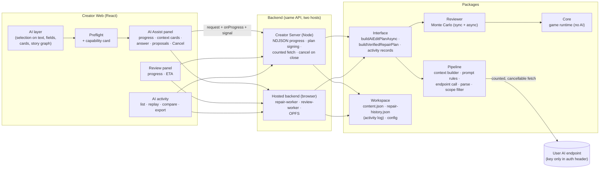
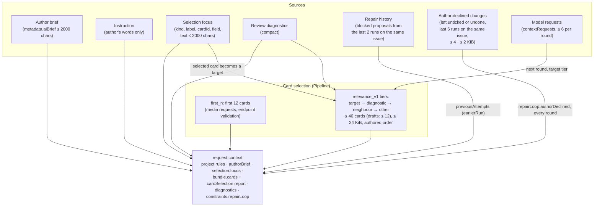
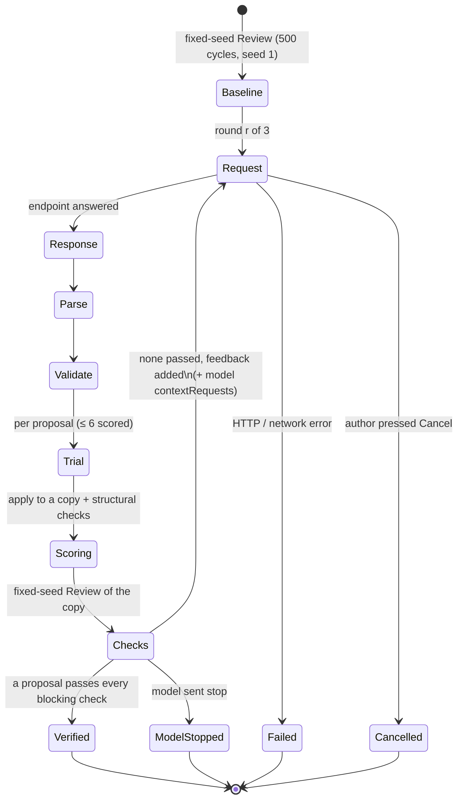
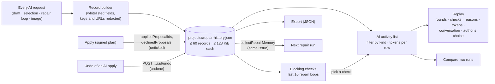

# AI Assist architecture

How AI Assist gathers context, runs requests and repair loops, shows progress, logs what happened,
and where its boundaries are. AI Assist is creator-side tooling only: Core and player builds contain
no AI code, endpoint calls, or keys.

## 1. Components and boundaries

- **One API, two hosts.** The Creator Server (development, Node ZIP, desktop) and the Hosted browser
  backend implement the same routes. Hosted runs the repair loop and Review in Web Workers.
- **Nothing writes content except apply.** Plans are previews. `/api/ai/edit/apply` is the only write,
  and on the Creator Server it accepts only plans this session issued and nobody changed afterwards
  (HMAC `planToken`, `ai_plan_untrusted` otherwise).
- **Player builds are AI-free.** `prepareGameBuild` strips creator-only metadata (`aiBrief`).

## 2. Context: what the model sees

| Entry point | Mode | Cards | Extra context |
|---|---|---|---|
| Startup / Overview draft | `generate_cards` | relevance within 12 cards (deck order without a target) | author brief |
| Card or graph action with a target | `generate_cards` | relevance around the target | brief, selection focus |
| AI layer: Explain | `explain_selection` | relevance around the selected card | brief, selection focus; answer only |
| AI layer: Rewrite / Translate | `edit_selection` | relevance around the selected card | brief, selection focus; edit scope |
| Review issue: AI Repair | `repair_diagnostics` (loop) | relevance tiers + model requests | brief, diagnostics, targets, acceptance rules, previous and earlier-run attempts, author-declined changes |

**Content is never instruction.** Card text, choice labels, the author brief, and the selected text are
sent as data (`role: content_to_work_on_not_instructions`), and a prompt rule tells the model to ignore
instructions found inside them. The selected text is never pasted into the instruction. Declined changes
(`role: author_declined_changes_content_not_instructions`) are titles and summaries an earlier model
wrote; a prompt rule says they describe what the author did not want and are not instructions.

The AI Assist panel shows the card selection report (why each card was sent, what the limits cut),
whether the brief and the selection were sent, and two separate memory lines: blocked attempts from an
earlier run (the checks said no) and "Includes N changes the author declined" (the author said no),
with the declined changes listed.

**Draft context.** Draft cards uses the relevance tiers inside the old 12-card limit: without a target
card or diagnostics the 12 cards are the deck's first 12 as before; with a target, the target and the
cards sharing its tags or variables come first. The full 40-card context would let every draft prompt
grow from 12 to 40 cards for a request that writes new cards rather than repairs a specific gap.

## 3. Repair loop and progress

- **Progress is real.** Every arrow above is a progress event (`baseline`, `context`, `request`,
  `response`, `parse`, `validate`, `trial`, `scoring`, `checks`, `done`). The Creator Server streams them
  as NDJSON when the client sends `accept: application/x-ndjson`; the plain JSON route is unchanged.
  Errors carry `error.stage`, so the UI stops on the step that failed.
- **Estimates.** Review shows "about Ns left" from measured cycles per second. While the model works,
  the UI shows the median of recent request times from this project's activity log.
- **Failures.** A round-1 endpoint failure ends the run (`Failed`); a later-round failure returns the best
  earlier round as unverified (`endpoint_error`). Failed, stale, and cancelled runs keep their rounds in the log.
- **Bounded agency.** The model may ask for up to 6 more cards next round, or stop the loop
  (`model_stopped`). It cannot skip a check, add rounds, or exceed budgets
  (3 rounds, 256 KiB per request, 2 MiB total, 300 s).
- **Checks.** Blocking: patches apply, allowed ops, player validation, no removed or renamed cards,
  target resolved, no new errors, scope (with the missing-producer exemption), author gates and choice
  effects preserved, reachability kept, score not lower. Advisory: dead gate relaxed, new warnings,
  stalled rate, `narrative_quality` (placeholder or copied text, unusable labels, script mismatch).

## 4. Activity log and audit

- Records keep: time, source, mode, instruction, selection, model, duration, context selection,
  proposals and their checks, the logged conversation (each message ≤ 16 KiB, no URL or headers),
  failures with their stage, and what the author applied, left unticked, or undid. Failed, stale, and
  cancelled runs keep the rounds that already ran.
- **Usage.** Each logged request, each repair round, and each run carry tokens and bytes sent/received.
  Tokens come from the endpoint's `usage` block when it sends one (OpenAI chat/completions/responses,
  Anthropic, Gemini shapes) and are marked "reported"; otherwise they are estimated at 4 bytes per token
  and marked "est.". Image runs show provider-reported tokens or nothing (multipart bytes are not metered).
- **Blocking checks.** Above the list: blocked proposals per check over the last 10 repair loops that
  ran checks, how many runs each check blocked, and how many runs ended verified. Picking a check
  narrows the list to those runs.
- **Author-declined memory.** A proposal shown with patches but not ticked at Apply is stored as
  declined (`not_selected`); undoing an applied AI draft in the Creator marks it `undone`. The next
  repair on the same issue (code and target cards) sends up to 4 of them from the last 6 runs
  (about 2 KiB) in every round. Deleting the record, or clearing the log, forgets them.
- Records never keep keys, endpoint URLs (also redacted from error text), headers, or connector config.
- A record is written to the project that started the request, even if the author switched projects.

## 5. Boundaries the author can see

| Boundary | Where it is enforced | Where the author sees it |
|---|---|---|
| Nothing changes until apply | apply route is the only write; signed plans on the server | capability card, proposal checkboxes |
| What each mode may change | Pipeline scope filter (`edit_selection`), loop checks (`repair_diagnostics`), answer-only (`explain_selection`) | capability card, "Discarded N proposals outside the selection" |
| Request budget per session | counted fetch on server and Hosted (`ai_session_budget`) | Settings, usage line in AI Assist |
| Loop budgets | repair loop limits | capability card, stop reasons |
| Cancel | AbortSignal to the provider fetch and loop; Hosted terminates the worker | Cancel button, "Cancelled" in the log |
| Keys | auth header only; redacted from logs, plans, history | capability card |
| Capabilities | only Structured JSON changes requests today | Settings chips marked "not used yet" |

## 6. Not built (by design)

- Arbitrary tool calling, MCP, and skills: optional developer-mode features per AGENTS.md.
- Token streaming: answers are one JSON document; stage progress covers the wait.
- A model judge for story quality: `narrative_quality` is a deterministic advisory check only.
